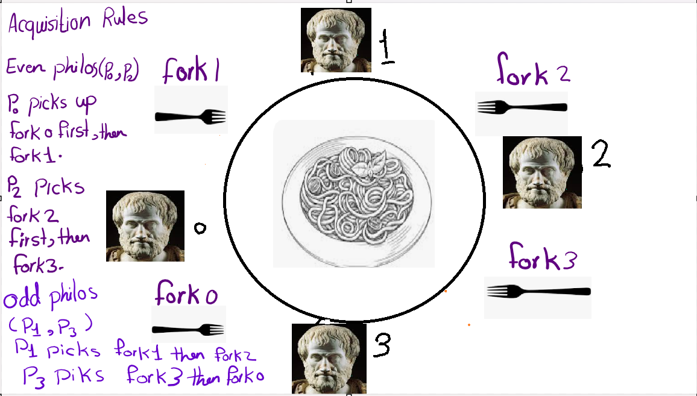

<h1 align="center">Philosophers 42</h1>

<p align="center">
  
  
  
  
</p>

## About

Philosophers is a 42 School project based on the classic Dining Philosophers problem.

The goal is to simulate philosophers sitting around a table, where each philosopher needs two forks to eat. The project focuses on:

* Threads
* Mutexes
* Synchronization
* Race conditions
* Deadlocks
* Timing
* Resource management

## How It Works

Each philosopher is represented by a thread.

A philosopher repeatedly:

1. Thinks
2. Takes two forks
3. Eats
4. Releases the forks
5. Sleeps

The simulation stops when a philosopher dies or, if the optional argument is provided, when all philosophers have eaten enough times.

<div align="center">
  
</div>


## Project Overview

| Part            | Implementation                  |
| --------------- | ------------------------------- |
| Language        | C                               |
| Threads         | POSIX `pthread`                 |
| Forks           | Mutexes                         |
| Synchronization | Mutexes                         |
| Build           | Makefile                        |
| Timing          | `gettimeofday` / time functions |
| Memory          | `malloc` / `free`               |

## Installation

Clone the repository:

```bash
git clone https://github.com/elel-m-b/PHILOSOPHERS.git
cd PHILOSOPHERS/philo
```

Compile:

```bash
make
```

## Usage

```bash
./philo number_of_philosophers time_to_die time_to_eat time_to_sleep [number_of_times_each_philosopher_must_eat]
```

Example:

```bash
./philo 5 800 200 200
```

With an eating limit:

```bash
./philo 5 800 200 200 7
```

### Arguments

| Argument                                    | Description                                                      |
| ------------------------------------------- | ---------------------------------------------------------------- |
| `number_of_philosophers`                    | Number of philosophers and forks                                 |
| `time_to_die`                               | Maximum time in milliseconds a philosopher can go without eating |
| `time_to_eat`                               | Time in milliseconds spent eating                                |
| `time_to_sleep`                             | Time in milliseconds spent sleeping                              |
| `number_of_times_each_philosopher_must_eat` | Optional eating limit for each philosopher                       |

## Example Output

```text
0 1 has taken a fork
0 1 has taken a fork
0 1 is eating
0 2 has taken a fork
200 1 is sleeping
200 1 is thinking
...
```

## Rules

* Each philosopher needs two forks to eat.
* A fork can only be used by one philosopher at a time.
* Philosophers must not access shared resources unsafely.
* Messages must not overlap.
* A philosopher dies if they do not eat within `time_to_die`.
* The simulation must avoid deadlocks and data races.
* All allocated resources must be properly released.

## Testing

You can test different numbers of philosophers and timings:

```bash
./philo 1 800 200 200
./philo 2 800 200 200
./philo 5 800 200 200
./philo 100 800 200 200
```

You can also use tools such as:

```bash
valgrind ./philo 5 800 200 200
```

## Cleaning

Remove object files:

```bash
make clean
```

Remove the executable and object files:

```bash
make fclean
```

Recompile everything:

```bash
make re
```

## What I Learned

This project helped me understand:

* POSIX threads with `pthread`
* Mutex-based synchronization
* Concurrent programming
* Race conditions
* Deadlock prevention
* Thread lifecycle management
* Precise time handling
* Safe access to shared resources
* Memory management in concurrent programs
